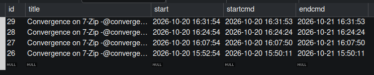

# Preuve de test SPO - 20 octobre 2026

**Etat de reference avant commit, 21 octobre :** correctif horaire installe sur
SPO. Reception et regroupement des demandes, installation via appel du passage
commun en console (deploiement 31) et non-reinstallation valides dans les
scenarios decrits. Une echeance temporairement avancee a teste le planificateur,
puis la configuration originale a ete restauree. Le passage normal de 10:42
avec demande, l'imaging reel et la convergence negative restent a valider.
Ce document conserve les etapes historiques : les mentions de travail local
ou de tests en attente plus bas doivent etre lues avec leurs mises a jour.

## Objet

Documenter la preuve d'un test fonctionnel realisé sur la VM `spo` après le déploiement du correctif de convergence / réconciliation d'identité sur le substitute Medulla.

## Reprise du 21 octobre : besoin initial et choix de traitement par lots

### Installation de recette sur SPO le 21 octobre

Installation autorisee par l'utilisateur sur l'etat de recette conserve de la
veille, sans nouveau snapshot impose. Aucun imaging ni retrait logiciel lance.

- Vers **09:39**, six fichiers installes : plugin resultinventory et acces
  Dyngroup du substitute ; modules MMC MSC, base MSC, base Dyngroup et base
  XMPP. Les quatre modules MMC installes avant intervention correspondaient
  exactement au HEAD local avant correctif : pas de personnalisation divergente
  observee sur ces fichiers.
- Sauvegarde coherente `--lock-all-tables` de `dyngroup`, `msc`, `xmppmaster`,
  `glpi`, archive gzip verifiee. Sauvegarde des six fichiers avant installation.
  Dossier serveur : `/root/medulla-tests/convergence-20261021/`.
- Redemarrage uniquement de MMC et du substitute inventaire. A **09:39:30**,
  les deux services sont actifs, `NRestarts=0`, MMC ecoute sur le port 7080 ;
  modules `msc` et `dyngroup` charges, acces Dyngroup du substitute connecte.
  Les six empreintes installees correspondent aux fichiers prepares.
- Table creee : `dyngroup.substitute_inventory_convergence`, cle primaire `id`,
  contrainte unique `machine_uuid`, revision initiale 1. File initialement vide.
- Etat de reference : convergence 1 / commande 26 active, poste UUID9,
  7-Zip present ; executions 26 a 30 seulement, derniere execution 30 reussie.
- Des erreurs de chargement d'autres modules, dont `admin`, sont visibles au
  demarrage MMC. Leur caractere preexistant n'est pas encore etabli ; elles
  ne doivent pas etre presentees comme un demarrage global sans erreur.
  Les modules cibles MSC/Dyngroup sont charges ; verifier aussi l'acces console.

**Installation effectuee, recette automatique en attente.** Les mentions de
validation locale ci-dessous ne prouvent pas encore la reception d'un inventaire
avec la version 1.22 ni une execution automatique a :42.

Pour une explication accessible aux commerciaux et au helpdesk, consulter la
[FAQ de fonctionnement et de diagnostic](./FAQ_CONVERGENCES_COMMERCIAUX_HELPDESK.md).
Elle distingue les comportements attendus des validations deja effectuees.

### Premier inventaire reel avec le correctif horaire

- **09:42:00,058** : premier passage automatique observe apres installation,
  `requests=0 machines=0 failed=False duration=0.058s` ; file vide, aucune
  nouvelle execution pour la commande 26.
- Inventaire de pro2 demande par l'utilisateur vers **09:55**.
- **09:55:58,236** : reception reelle de l'inventaire de
  `pc-win11pro-2.sad@pulse/54aebccabb1b`.
- **09:55:58,336** : signature runtime du plugin **1.22** effectivement installe.
- **09:55:59,591** : injection `mode=forward forward_done=True module_done=False`.
- **09:56:14,817** : `Inventory convergence requested`, cible **UUID9**.
- Controle SQL a **09:56:26** : une seule demande `id=1, machine_uuid=UUID9,
  revision=1` ; identite XMPP `id=84` conservee ; cibles MSC de la commande 26
  toujours limitees a **26 a 30**.

**Reception, injection et mise en attente reelles validees pour cet inventaire.**
Le poste conserve 7-Zip pour le test de conformite. Aucun clic de replanification
n'est demande. Traitement de cette demande attendu au passage de **10:42** :
l'acquittement et l'absence de nouvelle installation restent a verifier.

### Test anticipe du passage automatique : poste deja conforme

A la demande de l'utilisateur, le rendez-vous a ete temporairement avance,
sans clic sur « Replanifier » et sans appel a la replanification individuelle.

- Configuration : section `[msc]`, option `convergence_reschedule`, lue depuis
  `/etc/mmc/plugins/msc.ini` puis sa surcharge `/etc/mmc/plugins/msc.ini.local`.
  Il s'agit du planificateur interne MMC, pas de la crontab Linux.
- **09:59:28** : sauvegarde exacte du fichier `.ini.local`, puis expression
  temporaire `* * * * *` et redemarrage de MMC uniquement.
- **10:00:00,401** : `Scheduled convergence evaluated: command=26 candidates=0
  added=0 renew_window=False`.
- **10:00:00,402** : `Scheduled convergence pass: requests=1 machines=1
  failed=False duration=0.401s`.
- **10:00:02** : fichier original restaure et MMC redemarre.
- Controle **10:00:14** : expression effective **`42 * * * *`**, fichier
  restaure identique octet pour octet a sa sauvegarde ; MMC et inventaire
  actifs, `NRestarts=0`.
- File vide ; cibles et deploiements toujours **26 a 30** seulement.
  Aucun deploiement 31 pour la commande 26. Fenetre de commande inchangee :
  20 octobre 16:48:39 au 21 octobre 16:48:39.

**CONFORME pour la consommation automatique d'une demande concernant un poste
deja conforme : aucun ajout et aucune reinstallation.** Le vrai planificateur
a execute le nouveau traitement a une echeance avancee. Cela ne prouve pas
encore une reinstallation automatique de logiciel absent, un imaging reel,
ni un passage avec demande a l'horaire normal de :42.

Piece serveur : `advanced-schedule-evidence.log` dans le dossier de recette
du 21 octobre. Sauvegarde de configuration conservee dans ce meme dossier,
sans reproduire ses eventuelles donnees sensibles dans le rapport.

### Remise en conformite apres retrait : invocation du passage via pulse2-debug

L'utilisateur a retire 7-Zip de pro2 et demande un nouvel inventaire, sans
desactiver/reactiver la convergence ni utiliser sa replanification individuelle.

- **10:05:39** : nouvel inventaire integre dans GLPI ; controle SQL :
  **0 lien logiciel 7-Zip actif** pour l'ordinateur 9.
- **10:05:55,457** : demande de convergence enregistree pour UUID9.
  Controle a **10:06:07** : `id=2, machine_uuid=UUID9, revision=1`,
  identite XMPP 84 conservee, cibles toujours 26 a 30.
- L'utilisateur appelle dans la console authentifiee `pulse2-debug` :

  ```python
  msc.convergence_scheduled()
  ```

  Cette commande XML-RPC execute le passage commun dans MMC. Elle ne change
  pas le cron, mais peut traiter toutes les demandes presentes et les commandes
  proches d'expiration, pas uniquement pro2. Elle est distincte de
  `msc.convergence_reschedule_one(26)`, qui replanifie individuellement la commande.
  Transcription console fournie par l'utilisateur a **10:09:34**, documentant
  l'appel deja effectue (ce n'est pas la preuve d'un second appel a cette heure) :

  ```text
  ]> msc.convergence_scheduled()
  ''
  ]>
  ```

  Le retour vide `''` ne constitue pas un bilan de traitement ni une preuve
  de succes du deploiement. Le resultat est etabli par les journaux et controles
  SQL ci-dessous. Transcription textuelle fournie, pas une capture d'ecran.
- **10:06:44,884** : `Scheduled convergence evaluated: command=26 candidates=1
  added=1 renew_window=False`.
- **10:06:44,885** : `Scheduled convergence pass: requests=1 machines=1
  failed=False duration=0.122s`.
- Controle **10:06:58** : demande acquittee, cible **31 scheduled**,
  aucun deploiement XMPP 31 encore cree a cet instant.
- Controle **10:08:08** : deploiement **31 DEPLOYMENT START**, UUID9,
  session `convergence6991d87a3f4b46`. MSC indique deja `done` :
  cet etat seul n'etait pas une preuve de fin d'installation.
- Controle **10:09:02** : deploiement **31 DEPLOYMENT SUCCESS** ;
  inventaire GLPI du **10:08:59** contenant **7-Zip 26.04 (x64)**,
  version **26.04**.

**CONFORME pour la remise en conformite via le nouveau passage invoque en
console : absence inventoriee, demande consommee, une cible ajoutee, installation
reussie et presence confirmee par inventaire.** Le declenchement a ete anticipe
par un appel humain du traitement horaire, pas par la replanification individuelle.
Le parcours apres imaging reel et le passage normal de :42 avec demande restent
a verifier. L'inventaire post-installation peut creer une nouvelle demande :
son traitement devra rester sans nouvelle installation sur poste conforme.

### Controle de non-reinstallation apres le deploiement 31

L'inventaire post-installation du **10:08:59** a produit a **10:09:15,598**
une nouvelle demande UUID9. Controle a **10:10:39** :
`id=3, machine_uuid=UUID9, revision=1`, deploiement 31 reussi.

L'utilisateur a de nouveau appele `msc.convergence_scheduled()` dans
`pulse2-debug`, sans autre modification du poste.

```text
2026-10-21 10:11:57,518 INFO Scheduled convergence evaluated: command=26 candidates=0 added=0 renew_window=False
2026-10-21 10:11:57,520 INFO Scheduled convergence pass: requests=1 machines=1 failed=False duration=0.052s
```

Controle SQL a **10:12:11** : file vide, derniere cible MSC 31 (`done`),
dernier deploiement XMPP 31 (`DEPLOYMENT SUCCESS`, UUID9), aucune cible ni
execution 32 pour la commande 26.

**CONFORME pour cette reevaluation apres installation :** la nouvelle demande
est acquittee sans ajout ni reinstallation. Cette invocation console ne prouve
pas a elle seule le passage normal a :42, ni le parcours apres imaging.

### Inventaires rapproches et passage console du 10:16

L'utilisateur a demande trois inventaires puis invoque
`msc.convergence_scheduled()`. Les journaux montrent en fait **quatre receptions**
pour pro2 : trois a **10:14:59** et une a **10:15:09**, suivies de quatre
notifications UUID9 a **10:15:15,994**, **10:15:17,283**, **10:15:18,550** et
**10:15:26,043**. Ne pas assimiler le nombre de clics au nombre de receptions.

Une autre machine a aussi produit une demande : **UUID7**, a **10:16:40,924**.
Le passage console a donc traite deux machines, et non seulement pro2 :

```text
2026-10-21 10:16:43,587 INFO Scheduled convergence evaluated: command=26 candidates=0 added=0 renew_window=False
2026-10-21 10:16:43,589 INFO Scheduled convergence pass: requests=2 machines=2 failed=False duration=0.047s
```

Controle a **10:16:46** : file vide, derniere cible et dernier deploiement
toujours 31, ce dernier reussi ; aucune nouvelle installation.

**Regroupement observe indirectement :** quatre notifications UUID9 et une
notification UUID7 precedentes aboutissent a deux demandes traitees.
La ligne UUID9 et sa revision n'ont pas ete capturees avant l'appel console :
ne pas presenter ce test comme une observation SQL directe de la revision 4.
La cause des quatre receptions pour trois demandes utilisateur n'est pas etablie.

### Preparation du controle au rendez-vous normal de 10:42

Sans nouvelle invocation console, l'utilisateur a demande un inventaire de pro2.
Reception **10:21:19,182**, notification UUID9 **10:21:35,529**.
Controle SQL **10:22:02** : une demande **id=9, machine_uuid=UUID9, revision=1**,
dernier inventaire GLPI **10:21:19**. Le poste est laisse avec 7-Zip installe.

**Test en attente du passage normal de 10:42** : verifier ensuite le journal
du planificateur, l'acquittement et l'absence de nouvelle execution pour la
commande 26. Aucun resultat de ce passage n'est encore affirme.

**Le besoin initial reste ouvert : apres imaging, declencher automatiquement les
convergences des que le poste remonte, sans attendre la prochaine echeance
quotidienne et sans clic de replanification.**

La recette du 20 octobre prouve la reconciliation d'identite et des installations
avec replanification explicite. Elle ne prouve ni une reinstallation complete
par imaging avec convergence preexistante, ni un declenchement automatique.
Les conclusions de conformite plus bas sont limitees aux scenarios executes.

### Pourquoi ne pas recalculer les groupes pour chaque poste ?

Le premier prototype local parcourait les convergences actives pour chaque
poste inventorie. Cette approche a ete abandonnee avant deploiement :

- le filtre UUID ne suffit pas a limiter le travail : le chemin GLPI
  `getRestrictedComputersList` avec `gid` evalue le resultat complet du groupe
  avant de le croiser avec le filtre machine ;
- 10 000 postes et 100 convergences actives pourraient ainsi provoquer
  1 000 000 d'evaluations de groupes de deploiement, auxquelles s'ajoutent
  celles des groupes parents references par leurs criteres ;
- une file d'attente seule decale cette charge, mais ne la supprime pas.

### Fonctionnement retenu, en preparation locale sur dev

1. Apres injection reussie et reconciliation Dyngroup reussie, le substitute
   enregistre une notification durable dans
   `dyngroup.substitute_inventory_convergence` : `id` auto-incremente et
   `machine_uuid` unique, avec une `revision` entiere. Le plugin passe a la
   version **1.22**. Pour une meme machine, une nouvelle demande actualise
   atomiquement la ligne existante et incremente sa revision, sans empiler
   une notification par inventaire. Aucun contenu d'inventaire n'est conserve
   dans cette table et aucune comparaison de contenu n'est necessaire.
2. La tache MMC historique `msc.convergence_reschedule` utilise un passage
   commun `convergence_scheduled` : demandes d'inventaire et maintenance
   historique reutilisent le meme resultat de groupe par convergence.
   Son cron configurable reste inchange :
   par defaut `42 * * * *`, chaque heure a la **minute 42**.
   Le traitement des demandes d'inventaire examine les convergences actives
   sans attendre leur expiration ; la maintenance historique conserve sa
   selection des commandes expirant dans moins d'une heure.
   Aucune tache supplementaire a une ou dix minutes n'est conservee.
   Ce choix utilisateur favorise le regroupement sans multiplier les passages.
   Il ne rend pas chaque calcul moins couteux et ne remplace pas une mesure de charge.
3. Le passage fige **toutes les demandes presentes lors de sa lecture initiale**,
   avec leur identifiant et leur revision. Il n'y a plus de plafond de 100 000 :
   300 000 machines peuvent appartenir au meme passage, sans trois heures
   imposees par une limite de lecture. Une seule demande suffit a declencher
   le travail. Une seule execution du passage commun est autorisee.
4. Chaque convergence active necessitant un traitement est evaluee
   **une seule fois par passage** : le groupe de deploiement est calcule,
   puis croise avec les UUID remontes si la commande n'est pas proche d'expiration.
   Pour une commande proche d'expiration, ce meme resultat sert a la maintenance
   historique sur l'ensemble de son groupe, y compris hors des notifications.
   Il n'y a donc pas un second calcul pour la maintenance, ni pour chaque
   tranche de cibles. Sans notifications ni commandes proches d'expiration,
   aucun groupe n'est evalue par cette tache.
   Les dependances dynamiques du groupe restent calculees par le moteur existant.
   Aucun calcul incremental des criteres a l'echelle d'un poste n'est revendique.
   Deux convergences peuvent recalculer un meme sous-groupe parent : aucune
   memoisation globale des sous-groupes n'est livree. Une action manuelle
   explicite peut aussi provoquer une evaluation supplementaire hors du cron.
5. Les candidats non conformes sont ajoutes par tranches de **1 000 cibles
   maximum** dans le meme passage, sans attente d'une nouvelle heure et sans
   recalcul du groupe. Les controles d'execution MSC/XMPP sont refaits avant
   chaque tranche. Les commandes desactivees sont ignorees.
6. Les ajouts utilisent un verrou par commande, egalement partage avec les
   ajouts periodiques et manuels. Une execution XMPP non terminee bloque un
   nouvel ajout, meme si MSC indique deja `done`.
7. Pour le seul traitement inventaire, une fenetre expiree est renouvelee
   uniquement si un ajout est necessaire, sans replanification globale des
   anciennes cibles. Pour la maintenance historique des commandes proches
   d'expiration, le renouvellement et l'extension des cibles existantes restent
   conserves, meme si aucun ajout n'est necessaire.
8. Seules les demandes effectivement lues sont acquittees, une fois le passage
   evalue avec succes, **si leur identifiant et leur revision sont toujours
   ceux lus au debut**. Un inventaire arrive pendant le traitement actualise
   la ligne et empeche son effacement par cet ancien acquittement. Une nouvelle
   machine arrivee apres la lecture reste aussi en attente. Les acquittements
   sont fractionnes par 1 000 demandes, avec une transaction par tranche.
   En cas d'erreur, les notifications lues sont conservees et une erreur est
   journalisee ; les autres convergences sont quand meme examinees. Les tranches
   deja ajoutees restent presentes et sont exclues a la reprise par les gardes
   d'execution. Un passage interrompu ne fournit pas une transaction globale.

Le perimetre choisi avec l'utilisateur est **chaque inventaire reussi**, pas
uniquement un changement d'UUID : une reinstallation peut conserver son UUID.
Le groupe utilise les donnees effectivement integrees dans GLPI au moment
de son evaluation, pas les donnees de la notification. L'ensemble de demandes
est fige, **pas la base GLPI** : un inventaire plus recent peut deja etre visible
au calcul. Sa revision reste neanmoins en attente s'il est arrive apres la
lecture initiale, par precaution contre la course calcul/acquittement.
En mode forward, une reponse HTTP autre que 200 ne suffit pas a demander la
convergence ; en mode module, l'injection doit signaler son succes. Une reponse
HTTP 200 n'est cependant pas une preuve de fin d'import pour un serveur
d'inventaire qui traiterait les donnees de facon asynchrone.

### Convergences positives et negatives

Le passage commun concerne les deux polarites des convergences actives.
Il utilise leur groupe de deploiement existant et conserve la commande :
il ne transforme pas une desinstallation en installation.

| Polarite | Non-conformite dans les donnees GLPI disponibles | Action attendue |
|---|---|---|
| Positive | Logiciel attendu absent selon le critere configure | Installation via la commande existante |
| Negative | Logiciel interdit present selon le critere configure | Desinstallation via la commande existante |

Dans les deux cas, le poste doit appartenir au groupe concerne. Une convergence
desactivee est ignoree et une execution MSC/XMPP en cours bloque un doublon.
Pour une convergence negative, l'absence du logiciel est l'etat conforme :
aucune desinstallation n'est ajoutee lorsque le critere le reconnait absent.

Source du comportement existant : `createConvergenceUninstallGroups` dans
`medulla-dev/web/modules/dyngroup/includes/dyngroup.php` inverse les expressions
des groupes de deploiement et de conformite. Le formulaire de convergence
negative configure `parameterspacquage` avec `{"section":"uninstall"}`.
Le nouveau passage ajoute des cibles a cette meme commande, sans changer
ses parametres de paquet ni sa polarite.

**Statut : comportement attendu d'apres le code, pas une recette negative
reelle validee.** La recette SPO du 20 octobre portait sur l'installation.
Le paquet 7-Zip utilise dispose d'une commande de desinstallation vide :
les retraits Windows etaient manuels et ne prouvent pas une convergence negative.
Une recette dediee exige un paquet avec une section `uninstall` fonctionnelle :
logiciel present, inventaire, retrait automatique sans replanification manuelle,
inventaire d'absence, puis absence de nouvelle desinstallation.
Le succes doit etre controle dans l'etat de deploiement XMPP, les journaux
et l'inventaire, pas uniquement via MSC `done`.

### Charge et delai : limites explicites

- Pour 10 000 notifications distinctes et 100 convergences actives, sans
  erreurs ni nouvelles arrivees, le passage demande **100 appels
  d'evaluation des groupes de deploiement**, contre 1 000 000 avec la boucle
  par poste. Ce chiffre ne compte pas les sous-groupes ni les requetes SQL.
- Les tranches de 1 000 cibles par ajout sont une borne choisie pour cette
  implementation, **pas une valeur dimensionnee par un benchmark du parc**.
  Une demande par machine n'implique pas une installation pour chaque machine :
  seules les cibles non conformes et sans execution en cours sont ajoutees.
- A faible charge et sans arriere, la demande attend environ **0 a 60 minutes** jusqu'au
  prochain passage, puis viennent le calcul et le delai normal du moteur.
  Avec 1, 10, 10 000 ou 300 000 demandes presentes, elles sont toutes lues au
  meme passage, puis les cibles ajoutees par tranches successives. Il n'y a
  plus de report horaire impose par un plafond de lecture. Les arrivees
  posterieures a la lecture initiale attendent le passage suivant.
  Aucun delai global d'une heure n'est garanti en presence d'arriere,
  d'erreur ou de traitement long. Des inventaires repetes ne font plus grossir
  le nombre de lignes pour une meme identite GLPI. De nouvelles machines ou
  identites peuvent en revanche augmenter la file ; aucun effacement automatique
  des demandes de machines disparues n'est revendique.
- Le nombre de convergences et le cout de chaque groupe ne sont pas bornes.
  Le traitement et la lecture complete de la file restent synchrones dans MMC :
  memoire, duree d'un passage, latence de MMC et charge SQL doivent etre mesures.
  **Si un passage depasse une heure, la cadence horaire ne peut etre garantie.**
- Une erreur persistante conserve les demandes et impose leur reevaluation aux
  passages suivants ; elle doit etre diagnostiquee. Les nouveaux postes sont
  inclus dans la lecture suivante, sans etre exclus par un plafond de lecture.
- Les filtres, droits du proprietaire et criteres existants sont conserves.
  Un critere logiciel incorrect reste incorrect : ce mecanisme ne le corrige pas.

**Statut : implementation locale testee, non deployee sur spo.**
Un test automatise jusqu'a 300 000 demandes controle le nombre d'appels
d'evaluation par passage avec l'evaluation des groupes simulee. Il ne mesure pas
la performance de 10 000 vrais postes ni celle des groupes dynamiques en production.
La validation complete exigera ensuite un imaging reel, sans replanification
manuelle, et une mesure des horodatages inventaire / evaluation / lancement.

### Verifications locales du 21 octobre

- Suite inventaire : **56 tests reussis**, dont les 50 regressions precedentes.
  Le plugin complet est charge avec dependances simulees ; la file est aussi
  testee avec SQL reel sur SQLite.
- Suite MMC specifique : **23 tests reussis**, fonctions reelles extraites par
  AST. Elle couvre 1, 10, 10 000, 100 000 et 300 000 demandes (deux convergences
  simulees : exactement deux evaluations par passage, ajouts de 1 000 au maximum),
  la fusion des demandes, les nouvelles revisions, les nouvelles machines, les
  erreurs, les filtres, les commandes desactivees, les fenetres expirees et
  l'exclusion des executions XMPP non terminees.
  Un controle AST verifie l'absence de tache supplementaire et le maintien
  du cron historique configurable ; un test verifie que la maintenance historique
  et les demandes d'inventaire partagent un seul calcul par convergence. Un echec
  sur la seconde tranche est rejoue sans reinserer la premiere.
- MariaDB locale **11.8.6** : 10 000 lignes reelles inserees, lues et acquittees
  en dix lots de 1 000 lors du prototype precedent ; ce resultat historique
  ne valide pas le nouveau plafond de lecture de 100 000. Verrou par commande :
  acquisition refusee a une seconde connexion, puis possible apres liberation
  sur exception. Schema prive de test supprime et absence verifiee.
- Controle MariaDB du prototype avec plafond, desormais remplace : **100 001 notifications**
  inserees ; **100 000 lues en un seul passage**, puis acquittees par requetes
  de 1 000 identifiants dans une transaction. La notification excedentaire et
  une notification ajoutee apres lecture restent toutes deux presentes.
  Temps locaux observes : **0,311 s de lecture et 0,666 s d'acquittement**.
  Ces temps ne couvrent **ni les groupes, ni les cibles, ni les deploiements** :
  ce n'est pas un benchmark de parc. Schema prive de test supprime.
- Controle MariaDB du fonctionnement retenu : **300 000 demandes distinctes
  figees en une seule lecture**, puis 100 actualisations concurrentes de la
  meme machine via la vraie methode du substitute. Une seule ligne demeure
  pour cette machine, revision **101**. L'acquittement de l'ensemble initial
  conserve cette revision recente et une nouvelle machine arrivee apres lecture.
  Une demande supprimee puis recreee n'est pas effacee par un ancien acquittement.
  Temps locaux observes : **1,101 s de lecture et 34,498 s d'acquittements**
  conditionnels fractionnes. Ce dernier cout est significatif pour MMC synchrone ;
  ces mesures n'incluent ni groupes, ni cibles, ni deploiements et ne valident
  pas une capacite de 300 000 agents par heure. Schema prive supprime.
- Compilation syntaxique des huit fichiers Python ajoutes ou modifies :
  reussie, sans chargement complet des services.
- `git diff --check` : reussi dans les deux depots. Aucun acces ni changement
  sur spo pendant ces verifications.

Commandes de regression, depuis les racines respectives des depots, avec
Python et SQLAlchemy 1.4 disponibles :

```sh
# medulla-agent
python -m unittest discover -s test -p test_resultinventory_entity_sync.py
# medulla-dev
python -m unittest discover -s services/pulse2/tests -p test_inventory_convergence.py
```

Ces resultats ne remplacent pas le chargement complet des services sur spo,
la recette post-imaging ni un benchmark de groupes reels. Le complement
necessite le deploiement coordonne du substitute et de MMC ; les deux
composants creent la meme table de notifications si elle n'existe pas.
En retour arriere, arreter le consommateur et restaurer les fichiers sauvegardes ;
conserver la table et ses notifications tant que leur abandon n'a pas ete decide.

## Périmètre

- Service concerné : `pulse-xmpp-master-substitute-inventory.service`
- Correctif livré : revision `f351743a` (branche `dev`)
- Runtime observé : `plugin resultinventory` version `1.21`
- Machine testée : `pc-win11pro-2` dans l'environnement `spo`
- Cas validé : réception d'un inventaire réel et conservation de l'identité / appartenance Dyngroup

## Procédure de test

1. Capturer l'état initial avant inventaire.
2. Vérifier la machine XMPP / GLPI / Dyngroup avant l'inventaire.
3. Déclencher un inventaire sur `pc-win11pro-2`.
4. Vérifier le journal du service et la base de données après le traitement.
5. Conserver les captures log et les extraits SQL pour preuve.

## État avant le test

### Date de référence avant inventaire

- `2026-10-20 15:04:34` : capture de l'état initial avant envoi.

### Données observées avant le test

- Machine XMPP : `id=84`, hostname `pc-win11pro-2`, `uuid_inventorymachine=UUID6`, `id_glpi=6`
- GLPI machine associée : `id=6`, `name=pc-win11pro-2`, `uuid=C9A56C00-B9EB-11F0-9D6E-0C79326C3F00`
- Dyngroup : `Machine id=2`, `uuid=UUID6`, `name=pc-win11pro-2`, `FK_groups=5`

## Réception réelle de l'inventaire

### Journal de service

Extrait du fichier `/var/log/mmc/master-inv.log` :

```text
2026-10-20 15:05:55,711 - INFO - Received inventory from pc-win11pro-2.sad@pulse/54aebccabb1b in inventory substitute agent
2026-10-20 15:05:55,801 - INFO - resultinventory runtime identity: version=1.21 file=/usr/lib/python3/dist-packages/pulse_xmpp_master_substitute/pluginsmastersubstitute/plugin_resultinventory.py mode=forward enable_forward=True glpi_db=localhost:3306/glpi user=glpi
2026-10-20 15:05:57,088 - INFO - Inventory injection mode=forward forward_done=True module_done=False
```

## Vérification après traitement

### Exemple de contrôle SQL

```sql
SELECT id,hostname,uuid_inventorymachine,id_glpi
FROM xmppmaster.machines
WHERE id IN (84,87)
ORDER BY id;
```

Résultat observé :

```text
id  hostname       uuid_inventorymachine  id_glpi
84  pc-win11pro-2  UUID6                  6
87  pc-win11pro-3  UUID5                  5
```

### Contrôle GLPI

```sql
SELECT id,name,is_deleted,is_template,date_mod,last_inventory_update
FROM glpi.glpi_computers
WHERE id IN (5,6)
ORDER BY id;
```

Résultat observé :

```text
id  name          is_deleted  is_template  date_mod                   last_inventory_update
6   pc-win11pro-2  0           0            2026-10-20 15:05:55       2026-10-20 15:05:55
```

### Contrôle Dyngroup

```sql
SELECT m.id,m.uuid,m.name,r.id AS membership_id,r.FK_groups
FROM dyngroup.Machines m
LEFT JOIN dyngroup.Results r ON r.FK_machines=m.id
ORDER BY m.id,r.id;
```

Résultat observé :

```text
id  uuid      name          membership_id  FK_groups
1   UUID5     pc-win11pro-3  1              5
2   UUID6     pc-win11pro-2  2              5
```

### Contrôle de la file de reprise

```sql
SELECT COUNT(*) FROM dyngroup.substitute_pending_machine_identity;
```

Résultat observé :

```text
0
```

## Conclusion

Le test est validé sur la machine `pc-win11pro-2` :

- l'inventaire réel est bien reçu par le service ;
- le plugin de runtime est bien la version attendue (`1.21`) ;
- la fiche GLPI est mise à jour avec la bonne date d'inventaire ;
- l'identité XMPP est conservée ;
- l'appartenance Dyngroup est conservée ;
- aucune entrée de reprise n'est laissée en attente après le traitement.

Le test couvre le cas de réception d'un inventaire réel, sans démontrer encore le cas de suppression / recréation de la fiche GLPI ni la convergence complète sur un poste en production. Il constitue une preuve de validation fonctionnelle avant de poursuivre sur un scénario plus agressif.

## Fichiers de preuve

- `/var/log/mmc/master-inv.log`
- `/root/medulla-tests/convergence-20261020-dev-f351743a/windows-before-first-inventory.tsv`
- `/root/medulla-tests/convergence-20261020-dev-f351743a/windows-after-first-inventory.tsv`
- `/root/medulla-tests/convergence-20261020-dev-f351743a/windows-first-inventory.log`

## Test 2 - Suppression et recréation de la fiche GLPI

### Objectif et résultat attendu

Vérifier qu'un nouvel identifiant GLPI remplace l'ancien dans XMPP et Dyngroup,
sans perdre la fiche interne Dyngroup ni son appartenance au groupe 5.
Conserver `pc-win11pro-3` comme témoin.

### Actions et état intermédiaire

1. État initial sauvegardé avant suppression : GLPI **6**, XMPP **84 → UUID6**,
   Dyngroup **2 → UUID6**, appartenance `Results.id=2`, groupe **5**.
2. L'utilisateur a supprimé la fiche de `pc-win11pro-2` dans GLPI.
3. Contrôle serveur à **15:16:20** : la fiche **6 est absente**, et non simplement
   marquée supprimée ; aucune fiche ne correspond à son UUID matériel.
   Les liens XMPP et Dyngroup restent présents avec `UUID6`.
4. Après ce contrôle, l'utilisateur a relancé un inventaire sur ce Windows.

### Journal réel

```text
2026-10-20 15:17:15,621 - INFO - Received inventory from pc-win11pro-2.sad@pulse/54aebccabb1b in inventory substitute agent
2026-10-20 15:17:15,708 - INFO - resultinventory runtime identity: version=1.21 file=/usr/lib/python3/dist-packages/pulse_xmpp_master_substitute/pluginsmastersubstitute/plugin_resultinventory.py mode=forward enable_forward=True glpi_db=localhost:3306/glpi user=glpi
2026-10-20 15:17:17,083 - INFO - Inventory injection mode=forward forward_done=True module_done=False
```

Ces lignes prouvent la réception et le runtime utilisé. La réconciliation
réussie est établie par les relevés SQL suivants, pas par une ligne de succès
supplémentaire inventée : aucune ligne dédiée à cette réussite n'a été observée.

### Résultats SQL à 15:18:59

Les requêtes de contrôle sont celles du premier test, avec une sélection GLPI
par nom ou ancien ID, afin de retrouver la nouvelle fiche :

```sql
SELECT id,name,uuid,is_deleted,is_template,last_inventory_update
FROM glpi.glpi_computers
WHERE name IN ('pc-win11pro-2','pc-win11pro-3') OR id=6
ORDER BY id;
```

```text
id  name           uuid                                  is_deleted  is_template  last_inventory_update
5   pc-win11pro-3  FAF5E080-AAAC-11F0-85B4-4898013C4800  0           0            2026-10-20 14:53:13
9   pc-win11pro-2  C9A56C00-B9EB-11F0-9D6E-0C79326C3F00  0           0            2026-10-20 15:17:15
```

| Élément contrôlé | Avant suppression | Après nouvel inventaire | Résultat |
|---|---|---|---|
| ID GLPI de pro2 | 6 | 9, fiche active et non modèle | Conforme |
| UUID matériel de pro2 | `C9A56C00-B9EB-11F0-9D6E-0C79326C3F00` | Identique | Conforme |
| ID interne XMPP | 84 | 84 | Conservé |
| UUID inventaire XMPP | `UUID6` | `UUID9` | Actualisé |
| `id_glpi` XMPP | 6 | 9 | Actualisé |
| ID interne Dyngroup | 2 | 2 | Conservé |
| UUID Dyngroup | `UUID6` | `UUID9` | Actualisé |
| Ligne d'appartenance `Results.id` | 2 | 2 | Conservée |
| Groupe `FK_groups` | 5 | 5 | Conservé |
| File de reprise | Vide | Vide | Conforme |

Le témoin `pc-win11pro-3` conserve GLPI **5**, XMPP **87 → UUID5**,
Dyngroup **1 → UUID5**, appartenance **1** au groupe **5**.
Aucun profil d'imagerie n'est affecté dans `ProfilesResults` : ce passage
ne valide donc pas la conservation d'un profil existant.
Le service est `active/running`, `NRestarts=0` ; aucune erreur n'apparaît
dans l'extrait de journal du scénario.

### Verdict et limites

**CONFORME : le scénario réel de suppression/recréation GLPI est validé pour
la machine pro2 et son appartenance existante au groupe 5.** L'identité GLPI
passe de **6 à 9**, sans changement d'ID interne XMPP ou Dyngroup et sans perte
de la ligne d'appartenance contrôlée.

Ce résultat ne démontre pas encore l'exécution d'une convergence, un conflit
de profils, ni le scénario où l'ancienne fiche reste à la corbeille.
Un nouvel inventaire sur la fiche 9 permettra de contrôler la stabilité
et l'absence de doublon lors d'un passage répété.

### Pièces brutes conservées sur spo

Dans `/root/medulla-tests/convergence-20261020-dev-f351743a/` :

- `windows-before-glpi-recreation.tsv` ;
- `glpi-computer-6-before-recreation.sql.gz` (sauvegarde ciblée, non destinée à la diffusion) ;
- `windows-after-glpi-trash-before-inventory.tsv` ;
- `glpi-6-deletion-check.tsv` ;
- `windows-glpi-recreation.log` ;
- `windows-after-glpi-recreation.tsv`.

Les titres historiques contenant `trash` ne prouvent pas une mise à la corbeille :
le contrôle par ID a confirmé l'absence effective de la fiche 6.

## Test 3 - Inventaire répété après recréation

### Action et résultat attendu

L'utilisateur a relancé un inventaire sur `pc-win11pro-2`, sans suppression
supplémentaire. L'attendu est la stabilité de GLPI **9**, XMPP **84**,
Dyngroup **2** et de l'appartenance **2** au groupe **5**, sans doublon.

### Journal réel

```text
2026-10-20 15:21:41,485 - INFO - Received inventory from pc-win11pro-2.sad@pulse/54aebccabb1b in inventory substitute agent
2026-10-20 15:21:41,577 - INFO - resultinventory runtime identity: version=1.21 file=/usr/lib/python3/dist-packages/pulse_xmpp_master_substitute/pluginsmastersubstitute/plugin_resultinventory.py mode=forward enable_forward=True glpi_db=localhost:3306/glpi user=glpi
2026-10-20 15:21:43,039 - INFO - Inventory injection mode=forward forward_done=True module_done=False
```

### Contrôle SQL à 15:22:11

Les mêmes requêtes par nom et sur les appartenances ont été rejouées :

| Élément | Résultat observé |
|---|---|
| Fiche GLPI pro2 | Une seule fiche, ID **9**, active et non modèle |
| Date du dernier inventaire GLPI | **2026-10-20 15:21:41**, contre **15:17:15** avant ce passage |
| UUID matériel | `C9A56C00-B9EB-11F0-9D6E-0C79326C3F00`, inchangé |
| Machine XMPP pro2 | Une seule ligne pour ce nom, ID **84**, `UUID9`, `id_glpi=9` |
| Machine Dyngroup pro2 | Une seule ligne pour ce nom, ID **2**, `UUID9` |
| Appartenance pro2 | Une seule ligne, ID **2**, groupe **5** |
| File de reprise | Vide |
| Témoin pro3 | GLPI **5**, XMPP **87**, Dyngroup **1**, appartenance **1** au groupe **5**, inchangés |
| Service d'inventaire | `active/running`, `NRestarts=0` |

Aucune erreur n'est observée dans l'extrait de journal de ce passage.
Le premier contrôle à 15:21:16 précédait la réception de cet inventaire ;
la conclusion repose sur le contrôle ultérieur, après réception et traitement.

**Verdict : CONFORME pour ce passage répété.** La nouvelle identité reste stable
et les relevés ne montrent aucun doublon de fiche ou d'appartenance pour pro2.
Cela ne constitue pas encore une preuve d'exécution de convergence.

Pièces brutes dans le répertoire privé de déploiement sur spo :
`windows-repeated-inventory.log` et `windows-after-repeated-inventory.tsv`.

## Préparation convergence - Désinstallation de 7-Zip sur pro2

L'inventaire précédent indiquait **7-Zip 26.03 (x64)** sur pro2.
L'utilisateur a déclaré l'avoir désinstallé manuellement, puis avoir lancé
un nouvel inventaire. Aucune installation par convergence n'a encore été lancée.

Le contrôle à **15:31:51** précédait de cinq secondes la réception réelle :
il montrait encore l'ancien inventaire. Le contrôle suivant, à **15:34:55**,
confirme :

- fiche GLPI **9**, `last_inventory_update=2026-10-20 15:31:56` ;
- **0 lien logiciel actif correspondant à 7-Zip** pour cette fiche ;
- XMPP **84 → UUID9**, `id_glpi=9`, inchangé ;
- Dyngroup **2 → UUID9**, appartenance **2** au groupe **5**, conservés ;
- témoin pro3 inchangé sur les identifiants et liens contrôlés ;
- file de reprise vide.

Journal réel :

```text
2026-10-20 15:31:56,120 - INFO - Received inventory from pc-win11pro-2.sad@pulse/54aebccabb1b in inventory substitute agent
2026-10-20 15:31:56,233 - INFO - resultinventory runtime identity: version=1.21 file=/usr/lib/python3/dist-packages/pulse_xmpp_master_substitute/pluginsmastersubstitute/plugin_resultinventory.py mode=forward enable_forward=True glpi_db=localhost:3306/glpi user=glpi
2026-10-20 15:31:57,530 - INFO - Inventory injection mode=forward forward_done=True module_done=False
```

La requête de contrôle logiciel est celle du contrôle préparatoire :

```sql
SELECT COUNT(*) AS active_7zip_links
FROM glpi.glpi_items_softwareversions l
JOIN glpi.glpi_softwareversions v ON v.id=l.softwareversions_id
JOIN glpi.glpi_softwares s ON s.id=v.softwares_id
WHERE l.itemtype='Computer' AND l.items_id=9 AND l.is_deleted=0
  AND s.name LIKE '%7%zip%';
```

**Précondition confirmée côté inventaire : 7-Zip n'est plus remonté sur pro2.**
Il ne s'agit pas encore d'une preuve d'installation par convergence ni d'une
vérification indépendante du système de fichiers Windows.

Paquet candidat existant : **7-Zip 26.04**, UUID
`a0303e44-4f3e-576c-9f74-9afe06969720`, commande d'installation
`"7z2604-x64.exe" /S`. Sa commande de désinstallation est vide ; le retrait
manuel depuis Windows reste nécessaire pour ce scénario. Le snapshot serveur
ne restaure pas le Windows ni sa version initiale 26.03.

Pièces conservées dans le répertoire privé du déploiement :
`windows-7zip-removal-inventory.tsv` et `windows-7zip-removal-inventory.log`.

## Préparation convergence - Groupe dédié et captures

L'utilisateur a créé le groupe statique **RECETTE-CONVERGENCE-7ZIP-PRO2**.
Le contrôle SQL du **20 octobre 2026 à 15:44:12** confirme :

| Élément | Valeur observée |
|---|---|
| ID du groupe | **6** |
| Type | Statique (`type=0`) |
| Membre unique | `pc-win11pro-2`, `UUID9`, ID Dyngroup **2** |
| ID de l'appartenance au groupe de recette | **3** |
| Convergences configurées à ce contrôle | **0** |

La capture du formulaire prouve la sélection de pro2 seule avant validation ;
la capture suivante montre le groupe enregistré dans la liste. Elles ne
prouvent pas encore la création ou l'exécution d'une convergence.

### Captures fournies par l'utilisateur

Les sept images reçues à ce stade sont conservées dans
[captures-spo-2026-10-20/](./captures-spo-2026-10-20/).
Les copies sont identiques aux pièces jointes originales (comparaison SHA-256
effectuée lors de l'archivage), sans recadrage ni retouche.
Les heures ci-dessous sont celles des messages, pas des métadonnées des images.

| Message du 20 octobre | Capture | Portée |
|---|---|---|
| 14:44 | [01 - Sélection de la VM](./captures-spo-2026-10-20/01-proxmox-selection-vm-spo.png) | VM 107 (spo) dans Proxmox |
| 14:46 | [02 - Instantanés existants](./captures-spo-2026-10-20/02-proxmox-instantanes-existants.png) | Vue des points de retour existants |
| 14:49 | [03 - Instantané terminé](./captures-spo-2026-10-20/03-proxmox-creation-instantane-ok.png) | Tâche `qmsnapshot`, statut `stopped: OK` ; ne prouve pas une restauration |
| 15:38 | [04 - Capture partielle](./captures-spo-2026-10-20/04-medulla-groupes-capture-partielle.png) | Capture incomplète, conservée pour traçabilité |
| 15:40 | [05 - Groupes avant recette](./captures-spo-2026-10-20/05-medulla-groupes-avant-recette.png) | Groupe initial seul dans la liste |
| 15:43 | [06 - Formulaire du groupe pro2](./captures-spo-2026-10-20/06-medulla-formulaire-groupe-pro2.png) | Pro2 seule dans les membres sélectionnés |
| 15:46 | [07 - Groupe enregistré](./captures-spo-2026-10-20/07-medulla-groupe-recette-enregistre.png) | Groupe de recette visible avec le groupe initial |
| 15:48 | [08 - Paquet et convergence disponible](./captures-spo-2026-10-20/08-medulla-paquet-7zip-convergence-disponible.png) | Écran du groupe de recette, 7-Zip 26.04, convergence « Disponible » ; aucune exécution prouvée |
| 15:51 | [09 - Formulaire de convergence](./captures-spo-2026-10-20/09-medulla-formulaire-convergence-7zip.png) | Configuration avant validation, groupe pro2 et paquet 7-Zip ; ne prouve pas l'enregistrement ni l'activation |
| 15:53 | [10 - Convergence active](./captures-spo-2026-10-20/10-medulla-convergence-active.png) | État « Activé » ; ne prouve pas le succès de l'installation |
| 15:57 | [11 - Formulaire de désactivation](./captures-spo-2026-10-20/11-medulla-formulaire-desactivation-convergence.png) | Convergence encore activée, bouton « Désactiver » visible ; désactivation non encore confirmée |
| 16:06 | [12 - Convergence inactive avant reprise](./captures-spo-2026-10-20/12-medulla-convergence-inactive-avant-reprise.png) | État « Inactive », avant validation de la réactivation |
| 16:18 | [13 - Journal de l'échec initial](./captures-spo-2026-10-20/13-medulla-journaux-echec-initial.png) | Vue « Tous les journaux », filtre `conver`, événement du premier échec à 15:53:44 ; pas une nouvelle tentative |
| 16:23 | [14 - Succès avant replanification](./captures-spo-2026-10-20/14-medulla-convergence-succes-avant-replanification.png) | Vue Audit / Mes convergences, une machine et « SUCCES COMPLET GROUPE » ; avant test explicite d'idempotence |
| 16:31 | [15 - Inactive après correction du critère](./captures-spo-2026-10-20/15-medulla-inactive-apres-correction-critere.png) | Formulaire avant réactivation ; le critère corrigé est vérifié séparément en base |
| 16:35 | [16 - Quatre tentatives en base](./captures-spo-2026-10-20/16-sql-quatre-tentatives-convergence.png) | Lignes 26 à 29, titres et dates ; les états d'exécution ne sont pas visibles |


Ces captures contiennent des informations d'infrastructure. Leur archivage
local ne constitue pas une autorisation de diffusion publique.

## Test 4 - Première tentative de convergence 7-Zip : échec du paquet

Après validation du formulaire, l'interface affiche **Activé**.
Contrairement à l'annonce préalable de l'assistant, la convergence a été
créée **active**, et non inactive. L'étape de validation d'une convergence
inactive n'a donc pas été exécutée : elle ne doit pas être déclarée réussie.

Contrôles serveur à **15:53:56**, puis **15:54:05** :

- convergence **1**, groupe parent **6**, groupe de déploiement **7**,
  groupe de conformité **8**, `active=1` ;
- paquet `a0303e44-4f3e-576c-9f74-9afe06969720` ;
- commande **26**, titre réel `Convergence on 7-Zip -@convergence@-`,
  état `active`, redémarrage désactivé ;
- une cible de commande observée : **pc-win11pro-2.WORKGROUP, UUID9**,
  groupe de déploiement **7** ;
- session **convergence653a6353dc2248**, démarrée à **15:52:54**.

Le titre réel diffère du titre de recette proposé ; les preuves utilisent
les identifiants effectivement observés.

Le transfert a réussi, mais l'exécution du paquet a échoué :

```text
2026-10-20 15:53:34  Transfer complete
2026-10-20 15:53:44  [a0303e44-4f3e-576c-9f74-9afe06969720]: ERREUR - section "install" absente du descripteur (disponibles : uninstall)
2026-10-20 15:53:44  Package execution error
```

Ces extraits sont les champs `date` et `text` des événements de la session
dans `xmppmaster.logs`, avec les balises HTML de présentation omises.
État effectif dans `xmppmaster.deploy` :
**ABORT PACKAGE EXECUTION ERROR**.
Le champ `msc.commands_on_host.current_state` indique pourtant `done` :
il ne constitue donc pas une preuve de succès de l'installation.

**Verdict : NON CONFORME pour l'installation par convergence.**
Le ciblage de la nouvelle identité `UUID9` et le transfert vers pro2 ont
fonctionné, mais l'installation n'est pas validée. L'erreur signale une section
d'installation absente du descripteur ; il faut examiner et corriger le paquet
de recette avant une nouvelle tentative, sans conclure à une régression
du rapprochement d'identité.

La convergence reste active au dernier contrôle ; aucune modification du paquet
ni relance manuelle n'a été effectuée lors de ces vérifications.
Pièce serveur : `convergence-26-first-attempt.tsv` dans le répertoire privé
du déploiement.

### Désactivation après la première tentative

Après action « Désactiver » par l'utilisateur, contrôle SQL le
**20 octobre 2026 à 15:58:14** :

- convergence **1** : `active=0` ;
- commande **26** : `state=disabled`,
  `end_date=2026-10-20 15:57:52` ;
- une session observée pour cette commande, toujours en
  `ABORT PACKAGE EXECUTION ERROR` : `convergence653a6353dc2248`.

La désactivation est confirmée en base. Le descripteur du paquet contient
une commande d'installation, mais aucun marqueur `action_section_install`,
alors qu'un marqueur `action_section_uninstall` est présent. Le paquet
n'a pas encore été modifié ni relancé à ce contrôle.

### Correction du descripteur avant nouvelle tentative

Correction appliquée sur spo et vérifiée le **20 octobre à 16:00:36**,
convergence inactive :

- sauvegarde intégrale du descripteur original sous
  `7zip-descriptor-before.json` dans le répertoire privé du déploiement,
  avec copie hors VM ;
- ajout de `action_section_install`, label `label_section_install`, au step **0** ;
- décalage des cinq étapes existantes de **+1** ;
- aucune modification des commandes, du binaire, de l'identité du paquet
  ni des autres paramètres du descripteur ;
- permissions et propriétaire conservés : `0664`, `root:root`.

La comparaison structurelle vérifie qu'en retirant ce marqueur et en annulant
le décalage, le document JSON original est retrouvé exactement.

| Descripteur | SHA-256 |
|---|---|
| Avant | `937862dca5820b036b34148aa2e3a616a43d819f1906900f3e2462d0e2d515d3` |
| Après | `f4a920f08eed90429f2ce5d7648904a2398c7d7f433c8bedd1d5808816973679` |

Validation locale ciblée avec les méthodes réelles extraites par AST de
`pulse_xmpp_agent/lib/grafcetdeploy.py` :

1. Le sélecteur `install` entre à l'étape **1**, commande d'installation.
2. La frontière de section suivante mène au succès **4**, sans exécuter
   la commande de désinstallation à l'étape **3**.

Les dépendances d'exécution du poste sont simulées dans ce contrôle : il ne
prouve ni le transfert du descripteur corrigé ni l'installation Windows.
Le premier essai de ce contrôle local a échoué sur une méthode de journalisation
non simulée ; après ajout du simulacre manquant, les deux assertions passent.

Au contrôle serveur final : convergence **1 inactive**, commande **26 disabled**,
**une seule tentative** présente, celle en échec décrite plus haut.
La version corrigée est conservée sous `7zip-descriptor-after.json`, également
copiée hors VM. La désinstallation du paquet reste non configurée ; aucune
convergence de désinstallation ne doit être utilisée pour ce test.

**Statut : correction préparée et contrôlée ; nouvelle tentative réelle à faire.**

Avant réactivation, contrôle serveur à **16:06:58** : convergence **1** toujours
inactive, seule tentative **26** toujours en échec, groupe parent **6** contenant
uniquement **pc-win11pro-2 / UUID9**. Le SHA-256 du descripteur installé correspond
toujours à la version corrigée indiquée ci-dessus. Capture 12 archivée.

## Test 5 - Reprise après correction du paquet

Après validation par l'utilisateur, la convergence **1** et sa commande **26**
sont actives au contrôle de **16:08:04**. Une nouvelle exécution **27** a démarré
à **16:07:54**, session **convergencefb27be7c0d324b**, cible **UUID9 / pro2**.
L'exécution **26** en échec est conservée dans l'historique.

Au contrôle de **16:09:04**, `xmppmaster.deploy.state` pour l'exécution **27**
est **DEPLOYMENT SUCCESS**.

Extraits des événements de session (`date` et `text`, balises HTML omises) :

```text
2026-10-20 16:08:34  Transfer complete
2026-10-20 16:08:46  Starting package execution : a0303e44-4f3e-576c-9f74-9afe06969720
2026-10-20 16:08:46  [a0303e44-4f3e-576c-9f74-9afe06969720]-[1]: Starting Install section
2026-10-20 16:08:46  [a0303e44-4f3e-576c-9f74-9afe06969720]-[1]: [GoTo] Received return code: 0
2026-10-20 16:08:46  [a0303e44-4f3e-576c-9f74-9afe06969720]-[2]: End of section INSTALL
2026-10-20 16:08:46  [a0303e44-4f3e-576c-9f74-9afe06969720]-[4] :Execution successful
2026-10-20 16:08:46  Starting inventory
2026-10-20 16:08:46  Sending new inventory from pc-win11pro-2.sad@pulse : (generated in 5 s)
2026-10-20 16:08:46  DEPLOYMENT TERMINATE
```

**Résultat intermédiaire : le déploiement signale un succès et l'installeur
retourne 0.** Ce n'est pas encore la vérification indépendante de la version
installée ni de l'état de conformité de la convergence.

À **16:09:15**, la fiche GLPI **9** affiche encore le dernier inventaire
**15:31:56**, sans 7-Zip. Le groupe parent **6** conserve pro2 / `UUID9` ;
les groupes internes **7** et **8** n'ont pas de ligne `Results` observée.
Le nouvel inventaire et l'évaluation de conformité restent donc à contrôler.
XMPP conserve **84 → UUID9**, `id_glpi=9`.

Pièce brute serveur : `convergence-26-second-attempt.tsv`.
La convergence reste active à ce stade.

### Confirmation de la version par inventaire

Contrôles serveur à **16:11:00**, puis **16:11:10** :

- GLPI **9**, dernier inventaire **2026-10-20 16:09:34** ;
- logiciel actif remonté : **7-Zip 26.04 (x64)**, version **26.04** ;
- XMPP pro2 **84 → UUID9**, `id_glpi=9`, conservé ;
- Dyngroup **2 → UUID9**, liens **2 → groupe 5** et **3 → groupe 6** conservés ;
- file de reprise vide ;
- exécution **27** toujours en `DEPLOYMENT SUCCESS`.

Journal réel :

```text
2026-10-20 16:09:34,724 - INFO - Received inventory from pc-win11pro-2.sad@pulse/54aebccabb1b in inventory substitute agent
2026-10-20 16:09:34,920 - INFO - resultinventory runtime identity: version=1.21 file=/usr/lib/python3/dist-packages/pulse_xmpp_master_substitute/pluginsmastersubstitute/plugin_resultinventory.py mode=forward enable_forward=True glpi_db=localhost:3306/glpi user=glpi
2026-10-20 16:09:36,101 - INFO - Inventory injection mode=forward forward_done=True module_done=False
```

Cet inventaire précède le message utilisateur de **16:10:54** indiquant une
demande d'inventaire : il ne doit pas être attribué à cette nouvelle demande.
Il est compatible avec l'inventaire annoncé en fin de déploiement, sans preuve
de corrélation explicite entre les deux événements.

**Installation par convergence confirmée par le statut de déploiement,
le code retour 0 et la version remontée par un inventaire post-installation.**
La vérification visuelle ou locale indépendante sur Windows, le passage dans
le groupe de conformité et l'absence de nouvelle installation inutile restent
à contrôler. Aucune ligne `Results` des groupes internes 7/8 n'est observée
dans ce relevé ; cela ne suffit pas à conclure sur leur évaluation dynamique.

Pièces serveur : `windows-7zip-installed-inventory.tsv` et
`windows-7zip-installed-inventory.log`.

### Inventaire supplémentaire après installation

L'utilisateur signale un dernier inventaire à **16:11:34**.
Contrôle serveur à **16:12:56** :

- GLPI **9** confirme `last_inventory_update=2026-10-20 16:11:34` ;
- **7-Zip 26.04 (x64)** est toujours remonté, version **26.04** ;
- XMPP **84 → UUID9**, `id_glpi=9`, et Dyngroup **2 → UUID9** restent stables ;
- appartenances **2 → groupe 5** et **3 → groupe 6** conservées ;
- file de reprise vide ;
- seules les exécutions **26** (échec initial) et **27** (succès) sont présentes
  pour la commande **26** : aucune nouvelle exécution observée à ce contrôle.

```text
2026-10-20 16:11:34,774 - INFO - Received inventory from pc-win11pro-2.sad@pulse/54aebccabb1b in inventory substitute agent
2026-10-20 16:11:34,874 - INFO - resultinventory runtime identity: version=1.21 file=/usr/lib/python3/dist-packages/pulse_xmpp_master_substitute/pluginsmastersubstitute/plugin_resultinventory.py mode=forward enable_forward=True glpi_db=localhost:3306/glpi user=glpi
2026-10-20 16:11:36,053 - INFO - Inventory injection mode=forward forward_done=True module_done=False
```

Ce constat confirme la stabilité et l'absence de nouvelle exécution sur cette
période observée ; il ne prouve pas encore l'idempotence sur un cycle complet
d'évaluation ou après replanification explicite de la convergence.
Pièces serveur : `windows-7zip-repeat-after-install.tsv` et
`windows-7zip-repeat-after-install.log`.

### Cadence automatique : précision avant le test d'idempotence

La lecture du code installé sur spo confirme que la replanification automatique
sélectionne les commandes actives dont la date de fin est à moins d'une heure
(`end_date < maintenant + 1 heure`). La configuration observée utilise le cron
par défaut `42 * * * *`. La commande **26** expire le **21 octobre à 16:07:50**.

Attendre le prochain passage horaire ne garantit donc pas son évaluation :
le filtre de date peut encore l'exclure. Une replanification explicite de la
commande, via le parcours applicatif prévu, permettra un test borné sans
désactivation/réactivation. Elle n'a pas encore été demandée à ce stade.

L'affirmation antérieure selon laquelle les 24 heures n'étaient qu'une fenêtre
de validité était incomplète : cette fenêtre intervient aussi dans la sélection
automatique. Ce mécanisme préexiste au correctif d'identité et n'a pas été modifié.
Ce contrôle ne prouve pas un délai fixe de 24 heures pour chaque réinstallation.

### État avant replanification explicite

La capture utilisateur à **16:23** montre **Audit → Mes convergences**,
`Convergence on 7-Zip`, total **1** machine, statut **SUCCES COMPLET GROUPE**.
Le chemin d'interface correct est donc **Audit**, et non Historique.
Contrôle serveur à **16:23:16** : convergence **1** active, commande **26**,
toujours uniquement les exécutions **26** (échec initial) et **27** (succès).
Le relevé est conservé sous `convergence-before-idempotence.tsv`.
La replanification explicite n'est pas encore exécutée à ce contrôle.

## Test 6 - Replanification sur machine déjà équipée : anomalie observée

L'utilisateur a demandé la replanification depuis **Audit → Mes convergences**.
Le journal MMC confirme à **16:24:24** le contrôle de la commande **26**, puis
l'ajout d'une machine au groupe de déploiement **7** :

```text
2026-10-20 16:24:24,689 INFO Cron convergence: control of the command 26
2026-10-20 16:24:24,732 INFO 1 machines will be added to the convergence group 7
```

Au contrôle de **16:24:44**, une nouvelle ligne `commands_on_host.id=28`
est `scheduled`. À **16:24:55**, une nouvelle exécution **28** est effectivement
présente dans `xmppmaster.deploy` :

- état **DEPLOYMENT START** ;
- session **convergencedb5d9cee96a14a** ;
- début **16:24:54**, cible **pro2 / UUID9** ;
- GLPI indique pourtant toujours **7-Zip 26.04 (x64)**, version **26.04**,
  dernier inventaire **16:11:34**.

Les groupes internes 7 et 8 utilisent le critère logiciel
`Installed software (specific vendor and version)` avec
`Igor Pavlov, 7-Zip, 26.04`, combiné au groupe parent de recette.
Le résultat de ce critère doit être examiné avant d'attribuer l'anomalie
au moteur de replanification ou au correctif d'identité.

**Verdict : NON CONFORME pour l'absence de réinstallation inutile lors de cette
replanification.** Une exécution supplémentaire a été lancée ; son résultat
final n'est pas encore connu à ce contrôle. Ne pas déclarer ce test réussi sur
la seule base du précédent statut « SUCCES COMPLET GROUPE ».

Pièce brute serveur : `convergence-idempotence-first-check.tsv`.

### Désactivation après anomalie d'idempotence

Après action utilisateur, contrôle serveur à **16:26:41** :

- convergence **1** : `active=0` ;
- commande **26** : `state=disabled`, fin **16:26:23** ;
- exécution **28** : **DEPLOYMENT SUCCESS**, session
  `convergencedb5d9cee96a14a`, cible `UUID9` ;
- seules les exécutions **26**, **27**, **28** sont observées pour cette commande.

L'exécution supplémentaire a donc terminé malgré la désactivation ; son succès
ne rend pas le test d'idempotence conforme.

Le contrôle logiciel à **16:25:37** indique l'éditeur **Igor Pavlov**, la version
**26.04** et le nom inventorié **7-Zip 26.04 (x64)**, alors que le critère des
groupes internes utilise le nom **7-Zip**. Le code GLPI 10 installé transmet ces
trois champs au constructeur de filtres. La sémantique de comparaison reste
à examiner pour confirmer ou exclure cette différence de nom comme cause.
La convergence reste désactivée pendant ce diagnostic.

### Diagnostic du nom logiciel : comparaison confirmée

Contrôle à **16:27:58**, convergence **1** toujours inactive :

- le code GLPI 10 installé utilise `LIKE` sur le nom, sans ajouter de joker ;
  les jokers ne sont introduits que si le critère contient `*` ;
- le critère actuel ne contient pas de joker : `7-Zip` ;
- pour le logiciel réellement inventorié, la comparaison SQL
  `s.name LIKE '7-Zip'` retourne **0** ;
- `s.name LIKE '7-Zip 26.04 (x64)'` retourne **1** ;
- éditeur et version observés : **Igor Pavlov / 26.04**.

La différence de nom est donc un défaut confirmé du critère de recette :
le logiciel installé ne satisfait pas le nom demandé. Cela explique pourquoi
sa présence dans l'inventaire ne suffit pas à le déclarer conforme avec ce
critère. La validation de bout en bout après correction du critère reste à faire.
Aucune modification de critère ou de code applicatif n'a été effectuée
pendant ce diagnostic.

### Correction ciblée du critère de recette

À **16:29:33**, les requêtes des groupes internes **7** et **8** ont été
corrigées dans une transaction, convergence **1 inactive** :

- ancien triplet : `Igor Pavlov, 7-Zip, 26.04` ;
- nouveau triplet : `Igor Pavlov, 7-Zip 26.04 (x64), 26.04` ;
- expressions booléennes et groupe parent **6** inchangés ;
- aucune modification du moteur, du paquet ou de ses métadonnées globales.

Les critères originaux sont sauvegardés dans
`convergence-1-criteria-before.json` dans le répertoire privé du déploiement.
Le contrôle après écriture confirme les deux nouveaux critères et `active=0`.
Les seules exécutions restent **26**, **27**, **28** ; aucune replanification
n'a été demandée par cette correction.

Cette adaptation concerne uniquement les groupes de recette existants :
une recréation depuis les métadonnées inchangées du paquet pourrait réintroduire
le nom court. La réactivation et l'évaluation applicative restent à tester
avant de conclure sur l'idempotence avec le critère corrigé.

Contrôle préalable à **16:31:17** : convergence inactive, critères corrigés
toujours présents dans les groupes **7/8**, exécutions limitées à **26/27/28**.
Capture 15 conservée avant validation utilisateur.

### Réactivation avec critère corrigé : nouvelle exécution inattendue

Après validation utilisateur, contrôles à **16:32:08** et **16:32:19** :

- convergence **1 active**, commande **26 active**, début **16:31:53** ;
- critères corrigés conservés dans les groupes **7/8** ;
- nouvelle exécution **29**, session **convergencea3df93893d9c43**,
  début **16:31:54**, état **DEPLOYMENT START**, cible **pro2 / UUID9** ;
- GLPI **9** remonte toujours **7-Zip 26.04 (x64)**, version **26.04**,
  dernier inventaire **16:26:35**.

Le résultat attendu d'absence de nouvelle installation n'est donc pas obtenu
lors de cette réactivation. La correction du nom logiciel, bien conservée,
ne suffit pas à éviter ce lancement dans ce parcours.

Le journal MMC montre une reprogrammation de la commande à **16:31:53**,
puis le contrôle explicite de convergence, sans message d'ajout d'une machine
dans les lignes contrôlées de cette seconde. Cela ne suffit pas à établir
la cause du lancement : le parcours de réactivation doit être distingué
d'une replanification sur convergence déjà active.

**Verdict : résultat attendu non obtenu sur réactivation ; idempotence avec
critère corrigé non encore démontrée.** Le diagnostic précédent établit bien
la différence de nom, mais ne prouve pas qu'elle était l'unique cause
des tentatives supplémentaires. Résultat final de l'exécution 29 encore inconnu
à ces contrôles ; aucune nouvelle action de déploiement demandée par l'assistant.
Pièce serveur : `convergence-corrected-criterion-reactivation.tsv`.

### Capture SQL des quatre tentatives

Capture fournie par l'utilisateur à **16:35**, archivée sans retouche :



| ID d'exécution | `start` | `startcmd` | `endcmd` |
|---|---|---|---|
| 26 | 2026-10-20 15:52:54 | 2026-10-20 15:50:11 | 2026-10-21 15:50:11 |
| 27 | 2026-10-20 16:07:54 | 2026-10-20 16:07:50 | 2026-10-21 16:07:50 |
| 28 | 2026-10-20 16:24:54 | 2026-10-20 16:24:24 | 2026-10-21 16:24:24 |
| 29 | 2026-10-20 16:31:54 | 2026-10-20 16:31:53 | 2026-10-21 16:31:53 |

Cette image documente les quatre lignes et leurs horodatages. Elle ne montre
ni la cible ni le champ `state` : leurs valeurs proviennent des contrôles serveur
décrits plus haut. `endcmd` indique la borne de la fenêtre de commande,
pas l'heure de fin effective d'installation ni un délai fixe avant réinstallation.
Le résultat final de l'exécution 29 ne peut pas être déduit de cette capture.

### Contrôle après la quatrième tentative

À **16:37:45**, le contrôle serveur confirme l'exécution **29** en
`DEPLOYMENT SUCCESS`, convergence **1 active**, critères corrigés toujours
présents dans les groupes **7/8**. Aucune cinquième exécution n'est présente
dans le relevé.

La lecture du parcours de formulaire montre que la modification/réactivation
appelle une mise à jour de commande de déploiement puis une replanification.
Ce parcours n'est donc pas équivalent au seul bouton « Replanifier la
convergence ». La responsabilité exacte de chaque appel dans la création
de l'exécution 29 n'est pas encore établie.

Prochain contrôle prévu : replanification explicite sur la convergence
déjà active, avec les critères corrigés, sans repasser par le formulaire
de réactivation. L'absence de nouvelle cible et de nouvelle exécution doit
être vérifiée ; elle n'est pas présumée acquise.

## Test 7 - Replanification explicite avec le critère corrigé

L'utilisateur a cliqué une fois sur « Replanifier la convergence » dans
**Audit → Mes convergences**, sans désactivation/réactivation.
Le journal confirme l'évaluation de la commande **26** à **16:38:53** :

```text
2026-10-20 16:38:53,700 INFO Cron convergence: control of the command 26
2026-10-20 16:38:53,754 INFO msc: re-scheduling command id = <26> from 2026-10-20 16:38:53 to 2026-10-21 16:38:53
```

Contrôles serveur à **16:39:18**, puis **16:39:59** :

- convergence **1 active**, commande **26 active**, fenêtre actualisée à
  **20 octobre 16:38:53 → 21 octobre 16:38:53** ;
- critères corrigés conservés dans les groupes **7/8** ;
- **aucune nouvelle cible de commande** : seules les lignes **26/27/28/29**,
  toutes `done`, existent pour la commande **26** ;
- **aucune nouvelle exécution** : seules **26** (échec initial),
  **27/28/29** (succès) existent ; aucun déploiement **30** pour cette commande ;
- aucun message d'ajout d'une machine dans l'extrait MMC de cette évaluation.

**Verdict : CONFORME pour cette replanification explicite sur machine équipée,
avec le critère corrigé.** Le moteur a réévalué la commande sans programmer
de nouvelle installation. Ce résultat ne gomme pas les anomalies des essais
précédents, ne valide pas le parcours de réactivation et ne constitue pas
une observation prolongée des cycles automatiques.

Pièces serveur : `convergence-corrected-explicit-reschedule.tsv`,
`convergence-corrected-explicit-reschedule.log` et
`convergence-corrected-explicit-reschedule-followup.tsv`.

## Test 8 - Remise en conformité après désinstallation : préparation

L'utilisateur déclare avoir désinstallé **7-Zip 26.04** de pro2 et demandé
un inventaire. La convergence reste active, sans modification de ses critères.

Le contrôle initial à **16:43:27** précédait la réception du nouvel inventaire
et montrait encore le logiciel. À **16:44:23**, après réception :

- GLPI **9**, dernier inventaire **2026-10-20 16:44:07** ;
- **0 lien logiciel actif 7-Zip** sur la fiche 9 ;
- XMPP **84 → UUID9**, `id_glpi=9`, et Dyngroup **2 → UUID9**, conservés ;
- appartenances **2 → groupe 5** et **3 → groupe 6**, conservées ;
- file de reprise vide ;
- seules les exécutions **26 à 29** existent pour la commande **26**.

```text
2026-10-20 16:44:07,864 - INFO - Received inventory from pc-win11pro-2.sad@pulse/54aebccabb1b in inventory substitute agent
2026-10-20 16:44:07,962 - INFO - resultinventory runtime identity: version=1.21 file=/usr/lib/python3/dist-packages/pulse_xmpp_master_substitute/pluginsmastersubstitute/plugin_resultinventory.py mode=forward enable_forward=True glpi_db=localhost:3306/glpi user=glpi
2026-10-20 16:44:09,228 - INFO - Inventory injection mode=forward forward_done=True module_done=False
```

**Précondition confirmée côté inventaire : logiciel absent.** La replanification
de remise en conformité n'a pas encore été effectuée à ce contrôle. L'attendu
est une seule nouvelle tentative sur pro2, suivie d'un succès et d'un inventaire
confirmant 26.04 ; ces résultats ne sont pas encore acquis.

Pièces serveur : `convergence-remediation-before-reschedule.tsv` et
`convergence-remediation-removal-inventory.log`.

### Replanification et exécution de la remise en conformité

Après clic utilisateur, le journal MMC confirme à **16:45:28** le contrôle
de la commande **26** et l'ajout d'**une machine** au groupe de déploiement **7**.
Au contrôle à **16:45:42**, la cible **30** est `scheduled`, sans exécution
correspondante encore visible. Le déploiement démarre ensuite à **16:45:55**.

Contrôle à **16:46:53** :

- exécution **30**, session **convergenceb403351e8b3340** ;
- cible unique de cette nouvelle tentative : **pc-win11pro-2.WORKGROUP / UUID9** ;
- état **DEPLOYMENT SUCCESS**, code retour de l'installeur **0** ;
- fin de section INSTALL et succès signalés à **16:46:48** ;
- demande d'inventaire annoncée à **16:46:48** ;
- seules les exécutions **26 à 30** sont présentes pour la commande **26**.

Extraits des événements de session (`date` et `text`, balises HTML omises) :

```text
2026-10-20 16:46:48  [a0303e44-4f3e-576c-9f74-9afe06969720]-[1]: [GoTo] Received return code: 0
2026-10-20 16:46:48  [a0303e44-4f3e-576c-9f74-9afe06969720]-[2]: End of section INSTALL
2026-10-20 16:46:48  [a0303e44-4f3e-576c-9f74-9afe06969720]-[4] :Execution successful
2026-10-20 16:46:48  Starting inventory
2026-10-20 16:46:48  Sending new inventory from pc-win11pro-2.sad@pulse : (generated in 5 s)
2026-10-20 16:46:48  DEPLOYMENT TERMINATE
```

**Résultat intermédiaire : une seule tentative supplémentaire justifiée par
l'absence du logiciel, terminée en succès.** Le retour de la version 26.04
dans un inventaire post-réinstallation et la replanification sans réinstallation
sur machine de nouveau équipée restent à vérifier.

Pièces serveur : `convergence-remediation-start.tsv` et
`convergence-remediation-progress.tsv`.

### Confirmation de réinstallation par inventaire

Contrôle à **16:47:51** : GLPI **9** affiche un nouvel inventaire
**2026-10-20 16:47:35**, avec **7-Zip 26.04 (x64)**, version **26.04**.
L'exécution **30** reste en `DEPLOYMENT SUCCESS`, et seules les exécutions
**26 à 30** sont observées pour la commande **26**.

**Remise en conformité confirmée côté déploiement et inventaire :**
logiciel absent après désinstallation, une nouvelle tentative, puis version
attendue de nouveau inventoriée. Le contrôle final d'absence de réinstallation
sur nouvelle replanification reste à effectuer.
Pièce serveur : `convergence-remediation-inventory-check.tsv`.

### Replanification finale sur machine remise en conformité

Après clic utilisateur, le journal confirme l'évaluation de la commande **26**
à **16:48:39**, sans message d'ajout de machine dans l'extrait observé :

```text
2026-10-20 16:48:39,658 INFO Cron convergence: control of the command 26
2026-10-20 16:48:39,711 INFO msc: re-scheduling command id = <26> from 2026-10-20 16:48:39 to 2026-10-21 16:48:39
```

Contrôles à **16:48:54**, puis **16:49:35** :

- aucune nouvelle cible : seules les lignes **26 à 30**, toutes `done`,
  sont présentes pour la commande **26** ;
- aucune nouvelle exécution : uniquement **26 à 30**, aucun déploiement
  **31** pour cette commande ;
- au premier contrôle, convergence **1 active**, commande **26 active**,
  fenêtre actualisée à **20 octobre 16:48:39 → 21 octobre 16:48:39**.

**Verdict du Test 8 : CONFORME pour le scénario exécuté avec le paquet et
le critère corrigés.** Après désinstallation et inventaire d'absence,
une seule réinstallation est demandée par replanification explicite ;
le succès et la version sont confirmés, puis une nouvelle replanification
ne crée aucune installation supplémentaire.

Ce verdict ne couvre pas la cadence automatique, la réactivation depuis le
formulaire, les postes hors ligne, ni la conservation d'un profil d'imagerie.
La convergence reste active ; aucun retour arrière serveur ou Windows n'a
été effectué à ce stade.

Pièces serveur : `convergence-remediation-final-reschedule.tsv`,
`convergence-remediation-final-reschedule.log` et
`convergence-remediation-final-followup.tsv`.
